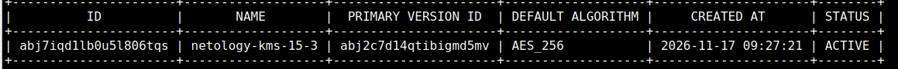
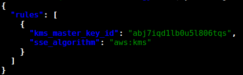
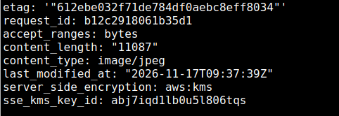

# Домашнее задание 15.3 — Безопасность в облачных провайдерах

## Задание 1. Yandex Cloud

С помощью Terraform создан ключ KMS и настроено шифрование содержимого ранее созданного бакета Object Storage.

Выполнена обязательная часть задания.

## 1. Создание ключа KMS

С помощью Terraform создан симметричный ключ шифрования.

**Параметры ключа:**

- Название: `netology-kms-15-3`
- ID: `abj7iqd1lb0u5l806tqs`
- Алгоритм: `AES_256`
- Ротация: раз в год
- Защита от удаления: включена
- Статус: `ACTIVE`

Terraform-конфигурация: [kms.tf](kms.tf).

### Результат



## 2. Настройка шифрования Object Storage

Использован бакет из предыдущего домашнего задания:

`pfccska777-netology-15-2-20261116`

В конфигурацию существующего бакета добавлено серверное шифрование SSE-KMS.

**Параметры шифрования:**

- Алгоритм: `aws:kms`
- KMS Key ID: `abj7iqd1lb0u5l806tqs`

Шифрование по умолчанию применяется к новым объектам бакета.

Изменение выполнено в существующем Terraform-проекте 15.2, который управляет бакетом.

Копия применённой конфигурации: [reference/storage.tf](reference/storage.tf).

### Проверка настроек бакета

Выполнена команда:

```bash
yc storage bucket get pfccska777-netology-15-2-20261116 \
  --full --format=json | jq '.encryption'
```

Результат подтвердил использование ключа KMS.



## 3. Шифрование содержимого бакета

После включения SSE-KMS загружен новый файл `kms-test.txt`.

Также повторно загружено изображение `image.jpg`, которое находилось в бакете до включения шифрования.

При загрузке изображения явно указаны алгоритм `aws:kms` и созданный ключ KMS.

### Проверка объекта

Выполнена команда:

```bash
yc storage s3api head-object \
  --bucket pfccska777-netology-15-2-20261116 \
  --key image.jpg
```

Результат:

```yaml
content_type: image/jpeg
server_side_encryption: aws:kms
sse_kms_key_id: abj7iqd1lb0u5l806tqs
```

Это подтверждает, что изображение зашифровано ключом KMS.



## 4. Проверка Terraform

Конфигурация проверена командами:

```bash
terraform fmt
terraform validate
terraform plan
```

Ключ KMS успешно создан с помощью Terraform.

Конфигурация бакета также успешно применена:

```text
Apply complete! Resources: 0 added, 1 changed, 0 destroyed.
```

## 5. Структура проекта

| Файл | Назначение |
|---|---|
| `providers.tf` | Настройка провайдера Yandex Cloud |
| `kms.tf` | Создание ключа KMS |
| `reference/storage.tf` | Копия Terraform-конфигурации зашифрованного бакета |
| `screenshots/kms-key.png` | Подтверждение создания ключа |
| `screenshots/bucket-encryption.png` | Настройки шифрования бакета |
| `screenshots/object-encryption.png` | Подтверждение шифрования изображения |

Файл `reference/storage.tf` приведён для демонстрации настроек. Управление существующим бакетом осуществляется из Terraform-проекта 15.2.

## Итог

Обязательная часть задания 15.3 выполнена.

Создан ключ KMS с алгоритмом AES-256. Настроено автоматическое серверное шифрование объектов в существующем бакете.

Проверено шифрование нового файла и ранее загруженного изображения.

Дополнительное задание по созданию статического сайта с HTTPS и задание AWS не выполнялись.
